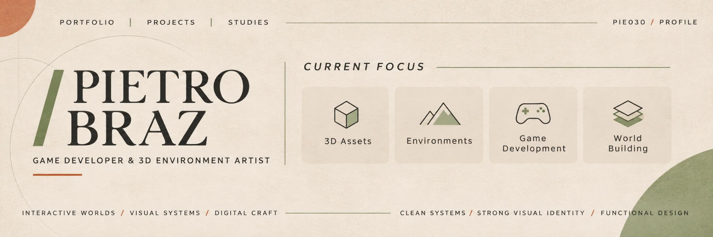

  

 

I build **interactive experiences and 3D environments** — from small web experiments to procedural worlds. I'm interested in the point where visual decisions, code and simulation meet.

### Selected work

**01 &nbsp; / &nbsp; Serra do Éter**  
*Procedural world · Vehicle simulation · 3D*  
An experimental open-world driving project with original vehicle models, generated environments, interactive systems and ongoing work on physics and performance.

**02 &nbsp; / &nbsp; Ethereal Nature**  
*Environment art · Stylized assets · Roblox*  
A collection of modular nature studies: trees, rocks and environmental details developed for stylized game environments, with attention to silhouette and efficiency.

**03 &nbsp; / &nbsp; Interactive Portfolio**  
*Web development · Visual identity · Motion*  
An evolving portfolio exploring editorial layout, interaction, typography and real-time 3D presentation.

These are evolving personal projects. Source code and playable demonstrations will be linked when they are ready to publish.

---

### Tools & interests

`JavaScript` &nbsp; `HTML / CSS` &nbsp; `Three.js` &nbsp; `Blender` &nbsp; `Roblox Studio` &nbsp; `Luau`

World building · Interactive prototyping · Simulation · UI design · Performance
