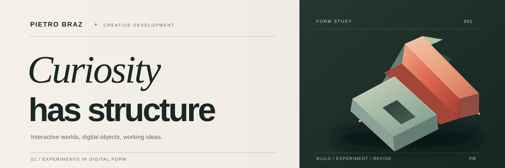
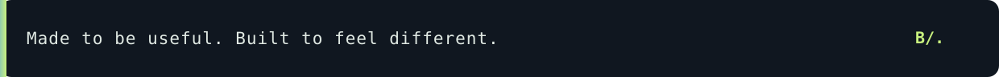

  

 

### Code, form and a little curiosity.

I'm a creative developer exploring the space between **interactive web experiences**, **3D environments** and **practical systems**. I enjoy making things that are thoughtful in how they work and distinct in how they feel.

I'm especially interested in procedural worlds, simulations, visual design and turning ideas into prototypes worth refining.

FOCUS &nbsp; / &nbsp; Creative development &nbsp;·&nbsp; 3D &amp; environments &nbsp;·&nbsp; Simulation &nbsp;·&nbsp; Product thinking

---

### Selected work

<table>
  <tr>
    <td width="50%" valign="top">
      
01 / INTERACTIVE WORLD

      <h3>Serra do Éter</h3>
      
An experimental open world combining procedural terrain, stylized 3D vehicles, driving systems and autonomous-agent prototypes.

      
<code>JavaScript</code> <code>3D</code> <code>Simulation</code>

      
Local prototypes · Preparing a public release

    </td>
    <td width="50%" valign="top">
      
02 / PRACTICAL SOFTWARE

      <h3>Rota Inteligente</h3>
      
A route-planning prototype for multiple deliveries, using real-world map data and heuristics to improve stop order.

      
<code>JavaScript</code> <code>Maps</code> <code>Optimization</code>

      
Prototype · Documentation in preparation

    </td>
  </tr>
  <tr>
    <td width="50%" valign="top">
      
03 / STYLIZED 3D

      <h3>Ethereal Nature</h3>
      
A study in modular, stylized natural assets — trees, rock formations and environment pieces created with game-world constraints in mind.

      
<code>Blender</code> <code>Low poly</code> <code>Environment art</code>

      
Asset development · Work in progress

    </td>
    <td width="50%" valign="top">
      
04 / DIGITAL PRESENCE

      <h3>Interactive Portfolio</h3>
      
An exploration of typography, motion, composition and 3D in a personal portfolio experience.

      
<code>HTML/CSS</code> <code>JavaScript</code> <code>Design</code>

      
In development

    </td>
  </tr>
</table>

### Tools & methods

**Web & interaction** — HTML, CSS, JavaScript  
**3D & worldbuilding** — Blender, Roblox Studio, Luau  
**Maps & routing** — Leaflet, OpenStreetMap, OSRM  
**Approach** — Build, test, observe, refine.

---

### What comes next

I'm organizing selected projects into public repositories with clear documentation, screenshots and usable demos. For now, the work above describes prototypes and creative studies; source repositories will be linked as they are released.

  

